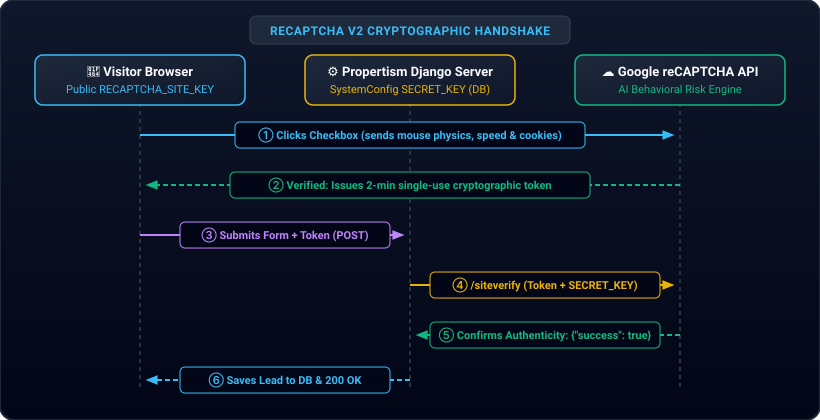

<!-- AUDIT METADATA -->
<!-- Date: 2026-10-18 -->
<!-- Time: 00:18 IST -->
<!-- Product Owner: Viji -->
<!-- Supervisor: Astra 1 -->
<!-- Module: 03-propertism -->
<!-- Status: EDUCATIONAL REFERENCE — HOW RECAPTCHA & DB KEYS PROTECT FROM SPAM -->
<!-- Git Commit: HEAD -->

# 🤖 How Google reCAPTCHA & DB-Backed Keys Defend Against Spam

> *"To a human, it looks like a simple checkbox. Under the hood, it is one of the most sophisticated AI and behavioral analysis systems on the web."*

---

## 🔍 The Illusion vs. The Reality

To a visitor, it looks like:  
> **"I just clicked a box that says 'I'm not a robot' — how hard is it for a computer program to click a box?"**

The secret is: **the checkbox is just a distraction.** The real test happens in the milliseconds **before, during, and after** you move your mouse toward that box.

---

## 🛠️ The 4 Defensive Layers Behind the Checkbox

### 1. The Physics of Your Mouse Movement (Human vs. Bot)
* **Humans are chaotic & organic**: When you move your mouse to click the box, your hand makes slight curves, decelerates as you near the target, makes tiny microscopic tremors, and hesitates for a fraction of a second before clicking.
* **Bots are mathematically rigid**: A bot script either snaps the cursor in a mathematically perfect straight line, or teleports instantly to the button with zero travel time, firing a synthetic `button.click()` event.
* Google’s script records the **exact trajectory, velocity, acceleration, and micro-movements** of your mouse as you move across the screen.

### 2. Browser Fingerprinting & Natural Behavior
Google silently inspects hundreds of clues in the background:
* **Time on Page**: A genuine human takes 10 to 30 seconds reading and filling out Name, Email, and Phone. A bot fills everything out and submits within 150 milliseconds.
* **Google Identity Cookies**: If your browser has a Google session cookie (you use Gmail, YouTube, or Google Search), Google's risk engine already knows your machine is tied to a legitimate, long-standing human account.
* **Real Hardware vs. Headless Scripts**: Bots often run automated tools (like Puppeteer or Selenium). Google tests graphics rendering (WebGL), audio hardware, and system fonts to verify it is running on a real computer/phone screen, not a server script.

### 3. The Puzzle Challenge (Fallback Gate)
* If your mouse movements, IP address, and browser pass the risk check, Google instantly gives you the **green checkmark**.
* If Google detects suspicious behavior (e.g., an unfamiliar IP address, robotic mouse movement, or no browsing history), it refuses to check the box and triggers the visual fallback: *"Select all squares with traffic lights, buses, or crosswalks."*

---

## 🔐 4. The Cryptographic Handshake (Why We Need DB Keys)

This is the most critical part that prevents automated spam, and explains why we set up `RECAPTCHA_SITE_KEY` and `RECAPTCHA_SECRET_KEY`:

* **Token Generation**: When you pass the checkbox, Google gives your browser a long, scrambled string called a **token** (e.g., `03AFcWeA6...`). This token is only valid for **2 minutes** and can only be used **once**.
* **Form Submission**: When you click "Submit", this token is submitted inside a hidden form field called `g-recaptcha-response`.
* **Backend Verification**: Our Django server receives the lead, pauses, and makes a secret private phone call to Google's servers:
  > *"Hey Google, this visitor gave me token `03AFc....` Here is our private `RECAPTCHA_SECRET_KEY` to prove it's Propertism asking. Did you actually approve this visitor?"*
* **Google Confirms**: Google replies `{"success": true}`. Only then does our Django server save the lead to PostgreSQL and send email notifications.

---

## 💡 Why Were Russian Bots Sneaking Through Earlier?

Understanding this reveals the exact vulnerabilities we eliminated in this session:

1. **The Missing Secret Key Loophole**: Previously, if `RECAPTCHA_SECRET_KEY` was missing from the server environment, the old code had a logic bug that assumed `success = True`!
2. **Direct API Bypassing**: Smart spam bots don't use web browsers at all. They write Python or curl scripts that send raw JSON directly to `/api/inquiries/` where there was no checkbox at all!
3. **Fail-Open Policy**: If Google’s API had a network hiccup or timeout, the old setting allowed the submission through (`RECAPTCHA_FAIL_OPEN = True`).

---

## 🛡️ How Today’s Work Fixed All Three

* **Locked the Public `/api/inquiries/`**: Scripts can no longer inject leads directly without authentication (`HTTP 401 Unauthorized`).
* **Moved Keys to PostgreSQL (`SystemConfig`)**: The server *always* has the credentials to verify tokens with Google directly from the database without server `.env` headaches.
* **Enforced Fail-Closed in Production**: If a token is absent, forged, or unverified by Google, Django completely blocks it at the gate!